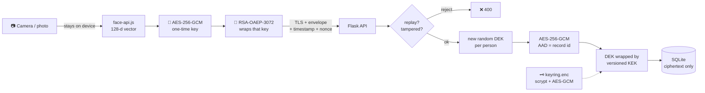

<div align="center">

```
███████╗ █████╗  ██████╗███████╗██╗   ██╗ █████╗ ██╗   ██╗██╗  ████████╗
██╔════╝██╔══██╗██╔════╝██╔════╝██║   ██║██╔══██╗██║   ██║██║  ╚══██╔══╝
█████╗  ███████║██║     █████╗  ██║   ██║███████║██║   ██║██║     ██║
██╔══╝  ██╔══██║██║     ██╔══╝  ╚██╗ ██╔╝██╔══██║██║   ██║██║     ██║
██║     ██║  ██║╚██████╗███████╗ ╚████╔╝ ██║  ██║╚██████╔╝███████╗██║
╚═╝     ╚═╝  ╚═╝ ╚═════╝╚══════╝  ╚═══╝  ╚═╝  ╚═╝ ╚═════╝ ╚══════╝╚═╝
```

### *Your face is not a password. You can't change it. So we never store it in the clear.*

**Biometric face encryption: facial feature vectors are encrypted before they ever touch the database.**


*A Cryptography & Network Security project*

</div>

---

## `// the problem`

Face recognition systems don't store photos. They store a **feature vector**: 128 numbers that
describe the geometry of your face. Leak that database and the damage is permanent:

- 🔓 a **password** leak is fixed by choosing a new password
- 🔒 a **face** leak can't be fixed, because you can't change your face

**FaceVault** is a full-stack face recognition system built around one rule:

> **A face template never exists in plaintext anywhere except in RAM, for the few milliseconds it takes to compare it.**

It is not stored in plaintext, not sent in plaintext, and not logged.

---

## `// what an attacker gets`

Steal the database file, and this is the whole loot:

```
┌──────────────────────────────────────┬─────────────────────────────────────────────────────┐
│ id                                   │ 9469eaf3-187e-4303-b849-1be1a357f2cf                │
│ email_index   (HMAC-SHA256)          │ 28dfcde75c88e51f1d68831acc8a35e23a9a4a6c66a67a9e35… │
│ template_ct   (AES-256-GCM, 528 B)   │ be8b6cedfffc550545507ab407ab1be16f35997834848e170d… │
│ template_nonce                       │ c0bad561e1bc9287b1dfde52                            │
│ pii_ct        (name + email)         │ 4c80dde8936732b24535f241e4ee0c21137ffb8209871153…   │
│ wrapped_dek   (DEK under KEK v1)     │ 64519720060b11a5e451fef91a07af4c7527ac027c8f78e2…   │
└──────────────────────────────────────┴─────────────────────────────────────────────────────┘
```

No faces, no names, no emails: just noise. The **DB inspector** page in the app shows exactly this,
live.

---

## `// how a face travels`



| # | Layer | What happens |
|:-:|---|---|
| **01** | 📷 **Capture in browser** | The face becomes a 128-number vector **inside the browser**. The photo never leaves the device. |
| **02** | 🛰️ **Transport encryption** | A fresh AES-256-GCM key encrypts the vector, and RSA-OAEP-3072 wraps that key. A timestamp and a random nonce make every request single-use. |
| **03** | ✉️ **Envelope encryption** | Each person gets their own random **DEK** (data key). The DEK is encrypted by a versioned **KEK** (master key). One leaked DEK exposes one person, not everyone. |
| **04** | 🔗 **Row binding** | The record ID is bound in as AAD. Copy Alice's ciphertext onto Bob's row and decryption fails. |
| **05** | 🙈 **Blind index** | Emails are encrypted too. Lookups use an HMAC-SHA256 "blind index", so the email is never stored readably. |
| **06** | 🧠 **Match in memory** | Templates are decrypted only in RAM to measure distance, then discarded. A failed match **never reveals its score**. |
| **07** | ⛓️ **Tamper-evident audit** | Every action is chained with HMAC-SHA256. Edit or delete one log line and the chain breaks at that exact entry. |

---

## `// the crypto toolbox`

| Purpose | Primitive | Why |
|---|---|---|
| Template + PII encryption | **AES-256-GCM** | Confidentiality *and* integrity in one pass, with a 96-bit random nonce every time |
| Per-person key | **256-bit random DEK** | Limits the damage of any single key leak |
| Key wrapping | **AES-256-GCM** under a KEK derived with **HKDF-SHA256** | Rotation re-wraps 32-byte keys and leaves the bulk data untouched |
| Keyring at rest | **scrypt** (N=2¹⁵, r=8, p=1) + **AES-256-GCM** | A memory-hard KDF makes passphrase brute force expensive |
| Transport | **RSA-OAEP-3072 (SHA-256)** + AES-256-GCM hybrid | The payload stays sealed even past a TLS-terminating proxy |
| Replay protection | ±120 s timestamp + 128-bit nonce cache | A captured request can't be replayed |
| Email lookup | **HMAC-SHA256** blind index | Equality search without plaintext |
| Passwords | **scrypt**, constant-time compare, dummy hash for unknown users | Resists GPU cracking and username enumeration |
| Sessions | **JWT HS256**, 30 min, algorithm pinned, `jti` revocation | Blocks `alg:none`; logging out really ends the session |
| Audit log | **HMAC-SHA256 hash chain** | Tampering is detectable |
| Network (optional) | Self-signed **ECDSA P-256** TLS + HSTS | Encryption on the wire |

---

## `// who can do what`

```
            ┌────────────────────────────── FaceVault ──────────────────────────────┐
            │                                                                        │
 👤 anyone ─┼──▶  Verify 1:1     "Is this face really priya@mail.com?"   (no sign-in)│
            │                                                                        │
 👑 super ──┼──▶  Dashboard · Enroll · Identify 1:N · Crypto lab · Subjects          │
    admin   │     DB inspector · Audit log · Keys · Operators                        │
            │                                                                        │
 🚫 others ─┼──▶  cannot sign in · cannot create accounts                            │
            └────────────────────────────────────────────────────────────────────────┘
```

- **One super administrator.** Only they can sign in, **enroll people**, run identification and
  manage keys. Their email is set in `backend/config.py` (`BFE_SUPER_ADMIN`).
- **Public verification.** Anyone can prove *"I am who I say I am"* with their email and face, no
  account needed.
- **No account creation.** Not in the UI, not through the API. These rules are enforced on the
  **server**, not just hidden in the page.

---

## `// built for every face`

A face detector that only works well on some people isn't secure, it's biased. FaceVault runs
detection as a **cascade** of different views of the same frame and stops at the first hit:

```
 raw frame ─▶ light-corrected ─▶ second detector ─▶ zoom: centre ─▶ zoom: upper ─▶ low-confidence
   (SSD)        (SSD, adaptive)     (TinyFaceDetector)   (digital zoom for people 1–3 m away)
```

- 🌗 **Adaptive light correction.** Contrast and brightness are measured *from the frame itself*,
  with the same curve on R, G and B. Skin hue is preserved and no skin tone is treated as the
  default.
- 🔭 **Distance.** Requests a 1080p camera, plus digital-zoom passes for faces a metre or more away.
- 💡 **Live guidance.** The camera badge says `too dark · add light`, `too bright · avoid glare` or
  `face · far · ok`.

**Measured** on 28 simulated 1080p webcam frames: 4 people with different skin tones; at
0.6 / 1 / 2 / 3 m; in dim light, backlit and overexposed:

| | single-pass detector | FaceVault cascade |
|---|:-:|:-:|
| Face **not detected** | 11 / 28 | **0 / 28** |
| Correct person recognised | 16 / 28 | **21 / 28** |

> ⚠️ The remaining misses are *recognition* limits (extreme overexposure, very low-resolution faces
> at 3 m), and the underlying embedding model was trained on data that under-represents some
> groups. See [Known limitations](#-known-limitations).

---

## `// quick start`

**You need:** Python 3.10+ · Node.js 20.19+ or 22.12+ · Chrome, Edge or Firefox

### 🪟 One command (Windows)

**PowerShell**
```powershell
cd "path\to\biometric-face-encryption"; .\start.bat
```

**Command Prompt**
```bat
cd /d "path\to\biometric-face-encryption" && start.bat
```

`start.bat` installs the Python and npm dependencies, builds the TypeScript frontend, starts the
server and opens **http://localhost:5000**. Press <kbd>Ctrl</kbd>+<kbd>C</kbd> to stop it.

### 🐧 Manually (any OS)

```bash
cd frontend
npm install
npm run build             # tsc type-check, then Vite build → frontend/dist
cd ../backend
pip install -r requirements.txt
python app.py             # API + frontend on http://localhost:5000
```

### 🔑 First sign-in

On the first run the super-admin account is created and its password is:

- printed in the server window, and
- saved to `backend/instance/ADMIN_PASSWORD.txt` (delete it once you've noted the password).

Lost it? Run `python reset_admin.py` in `backend/`.

### ⚡ Developer mode (hot reload)

```bash
cd frontend
npm run dev:full          # Flask on :5000 + Vite on http://localhost:5173 (proxies /api)
```

### 🔒 HTTPS mode

```bash
cd backend
python app.py --https     # self-signed cert → https://localhost:5443
```

---

## `// deploy (Vercel + Render)`

```
 Browser ──HTTPS──▶  Vercel   (frontend/dist, static)
                        │  /api/*  forwarded by frontend/vercel.json (same origin: no CORS)
                        ▼
                     Render   (Flask + gunicorn, exactly 1 instance)
                        └── persistent disk /var/data: biometric.db + keyring.enc
```

The backend can't run on Vercel: it needs a **persistent disk** (database and keyring) and **one
long-lived process** (the transport key, replay cache and rate limits live in memory).

**1 · Backend on Render**
1. Render dashboard → **New → Blueprint** → pick this repo. It reads [`render.yaml`](render.yaml).
2. Enter `BFE_SUPER_ADMIN` and a strong `BFE_ADMIN_PASSWORD` when asked. `BFE_MASTER_PASSPHRASE`
   is generated for you.
3. Deploy, then open `https://<your-service>.onrender.com/api/health`. It should return `{"status":"ok"}`.

> `render.yaml` uses a paid instance type because the free type has no persistent disk: every
> restart would wipe enrolled faces and the keyring.

**2 · Frontend on Vercel**
1. Vercel → **Add New → Project** → import this repo, and set **Root Directory** to `frontend`.
   Everything else comes from [`frontend/vercel.json`](frontend/vercel.json).
2. If your Render URL isn't `https://facevault-api.onrender.com`, change the `rewrites` destination
   in `frontend/vercel.json` and push.
3. Deploy. The footer status should read **Online**.

| File | Role |
|---|---|
| `render.yaml` | Render Blueprint: gunicorn with 1 worker, persistent disk, env vars, health check |
| `backend/wsgi.py` | Production entry point (`gunicorn wsgi:app`) |
| `frontend/vercel.json` | Vite build, `/api` forwarding to Render, security headers, asset caching |
| `BFE_TRUSTED_PROXIES` | Set to `2` on Render (Vercel → Render), so rate limits and HTTPS see the real client |

---

## `// configuration`

All credentials and settings live in a **`.env`** file in the project root, which is read
automatically at start-up and is **git-ignored**. Start from the template:

```bash
cp .env.example .env      # Windows: copy .env.example .env
```

Then fill in your own values. Real environment variables, if set, take priority over `.env`.
**Set a strong passphrase before storing real faces.**

| Variable | Default | Meaning |
|---|---|---|
| `BFE_MASTER_PASSPHRASE` | dev passphrase ⚠️ | Unlocks the encrypted keyring |
| `BFE_SUPER_ADMIN` | see `config.py` | The only account that can sign in |
| `BFE_ADMIN_PASSWORD` | random, printed once | Super-admin password; applied on every start-up, so edit `.env` and restart to change it |
| `BFE_MATCH_THRESHOLD` | `0.5` | Max face distance for a match (lower = stricter) |
| `BFE_JWT_TTL_MINUTES` | `30` | Session lifetime |
| `BFE_DATA_DIR` | `backend/instance` | Where the database and keyring live |
| `BFE_TRUSTED_PROXIES` | `0` | Reverse-proxy hops to trust for client IP and HTTPS (`2` behind Vercel → Render) |

> **Changing the passphrase later?** Run `python change_passphrase.py` in `backend/` first. It
> re-encrypts the keyring under the new passphrase (keeping a backup), then you update `.env`.
> Changing `.env` alone would lock you out of the existing keyring.
>
> **Run only one server at a time.** Each server keeps its own copy of the keys in memory, so a second
> copy would miss key rotations done by the first. FaceVault refuses to start if port 5000 is busy.

---

## `// threat model`

| Threat | Defence |
|---|---|
| 💾 Database file stolen | Everything is ciphertext; the keys live in a separate encrypted keyring |
| 🗝️ Database **and** keyring stolen | The keyring is AES-GCM encrypted under an scrypt-derived key |
| 🕵️ Insider edits or swaps a template | The GCM tag fails and the record is flagged **TAMPERED**; the AAD blocks row swaps |
| 📡 Eavesdropping / MITM | TLS, plus hybrid payload encryption, plus a key fingerprint shown in the UI |
| 🔁 Replaying a captured verification | Timestamp window and a single-use nonce |
| 🧗 Hill-climbing the match score | No score is returned on failure; rate limit of 20/min per IP |
| 🔨 Password brute force | scrypt, rate limits, 15-minute lockout after 5 failures |
| 💉 XSS / clickjacking | Strict CSP with **no third-party origins**, text-node-only DOM, `X-Frame-Options: DENY`, token kept in memory only |
| 🧹 Covering tracks | HMAC-chained audit log with one-click verification |
| 🔑 Key compromise | KEK rotation plus crypto-shredding of retired keys |
| 🗑️ Right to be forgotten | Delete the row; SQLite `secure_delete=ON` overwrites the bytes |

### 🧩 Known limitations

- **No liveness detection.** A printed photo can fool the camera. Blink or motion challenges, or a
  depth sensor, would fix this.
- **Matching needs decryption.** Homomorphic encryption or secure multi-party computation could
  match on ciphertext, at a large performance cost.
- **Biometrics can't be revoked.** *Cancelable biometrics* (keyed random projection) is future
  work.
- **Model bias.** The face-embedding model was trained on data that under-represents some groups.
  Detection is now robust across skin tones; *recognition* accuracy still depends on the model.
- **Python can't wipe memory reliably.** Production would keep the KEK in an HSM or cloud KMS.
- **The rate limiter and token denylist are in memory.** Use Redis when running several server
  instances.

---

## `// a 2-minute demo`

1. **Sign in** as the super admin, open **Enroll**, start the camera and enroll yourself.
2. Open **DB inspector**: only hex ciphertext. Search the `.db` file for your name: it isn't there.
3. **Sign out**, open **Verify 1:1**, and verify with your email and face ✅. Let a friend try
   your email ❌ (and notice no score is shown).
4. Open the **Crypto lab**: the 128-d heatmap, the real network envelope, and live **bit-flip** and
   **row-swap** attacks being caught.
5. Open **Keys** and click **Rotate KEK**. Everything still verifies. Retire v1 to crypto-shred it.
6. Edit one audit row in a SQLite browser, then click **Verify HMAC chain**. It names the exact
   broken entry.

---

## `// project map`

```
biometric-face-encryption/
├── start.bat                    one-command install + build + run (Windows)
├── .env.example                 credentials template (copy to .env, which is git-ignored)
├── render.yaml                  Render Blueprint for the backend
├── backend/                     Python · Flask · cryptography
│   ├── app.py                   REST API, routes, TLS bootstrap
│   ├── crypto_engine.py         keyring, envelope + transport encryption, blind index, audit MAC
│   ├── database.py              SQLite schema, queries, HMAC audit chain
│   ├── security.py              JWT, super-admin guard, rate limiting, security headers
│   ├── config.py                settings (all overridable by environment variables)
│   ├── reset_admin.py           reset the super-admin password
│   ├── change_passphrase.py     re-encrypt the keyring under a new passphrase
│   ├── wsgi.py                  production entry point (gunicorn)
│   └── tests/test_security.py   27 security tests
└── frontend/                    TypeScript · Tailwind CSS 4 · Vite
    ├── index.html               page structure
    ├── vercel.json              Vercel build, /api forwarding, security headers
    ├── scripts/copy-models.mjs  copies face models from node_modules (works offline)
    └── src/
        ├── main.ts              entry point and wiring
        ├── views.ts             one loader / action per screen
        ├── face.ts              detection cascade, light correction, digital zoom
        ├── crypto.ts            WebCrypto RSA-OAEP + AES-GCM transport encryption
        ├── api.ts · dom.ts      typed fetch, XSS-safe DOM builder
        ├── effects.ts           theme toggle, bubble page loader, marquee
        └── styles.css           design system (charcoal + acid green, neo-brutalist)
```

---

## `// REST API`

| Method | Path | Who | Purpose |
|---|---|---|---|
| `GET` | `/api/health` | anyone | Health check |
| `GET` | `/api/crypto/public-key` | anyone | RSA transport key + fingerprint |
| `POST` | `/api/auth/login` | anyone | Sign in (only the super admin succeeds) |
| `POST` | `/api/verify` | anyone | 1:1 verify `{email, envelope}` |
| `POST` | `/api/auth/logout` | 👑 | Revoke the session |
| `GET` | `/api/stats` | 👑 | Dashboard counters |
| `POST` | `/api/subjects` | 👑 | Enroll `{name, email, envelope{descriptors[]}}` |
| `GET` | `/api/subjects` | 👑 | List people (names decrypted, emails masked) |
| `DELETE` | `/api/subjects/<id>` | 👑 | Delete a person |
| `POST` | `/api/identify` | 👑 | 1:N search |
| `GET` | `/api/inspector` | 👑 | Raw encrypted rows |
| `POST` | `/api/crypto/demo` | 👑 | Step-by-step crypto walkthrough |
| `GET` | `/api/audit` · `/api/audit/verify` | 👑 | Audit log and chain check |
| `GET` · `POST` | `/api/keys` · `/api/keys/rotate` | 👑 | KEK status and rotation |
| `POST` | `/api/keys/<v>/retire` | 👑 | Crypto-shred an unused KEK |
| `GET` | `/api/operators` | 👑 | List accounts (creating accounts is disabled) |

---

## `// tests`

```bash
cd backend
python -m unittest discover -v tests
```

**27 tests** cover: encrypt/decrypt round-trip · randomised ciphertext · bit-flip detection ·
row-swap detection · key rotation and crypto-shredding · wrong keyring passphrase · blind index ·
transport replay, stale and tampered envelopes · audit-chain tampering · login lockout · super-admin
only sign-in · disabled account creation · public verify vs. protected enroll · token revocation ·
full enroll → verify → identify → rotate flow · *no plaintext in the database file* · proxy
headers (real client IP + HTTPS behind Vercel/Render, spoofing ignored locally) · production entry point.

---

<div align="center">

**FaceVault** · built for *Cryptography & Network Security*

`zero plaintext at rest` ✱ `AES-256-GCM` ✱ `RSA-OAEP-3072` ✱ `HMAC-SHA256` ✱ `scrypt`

</div>
